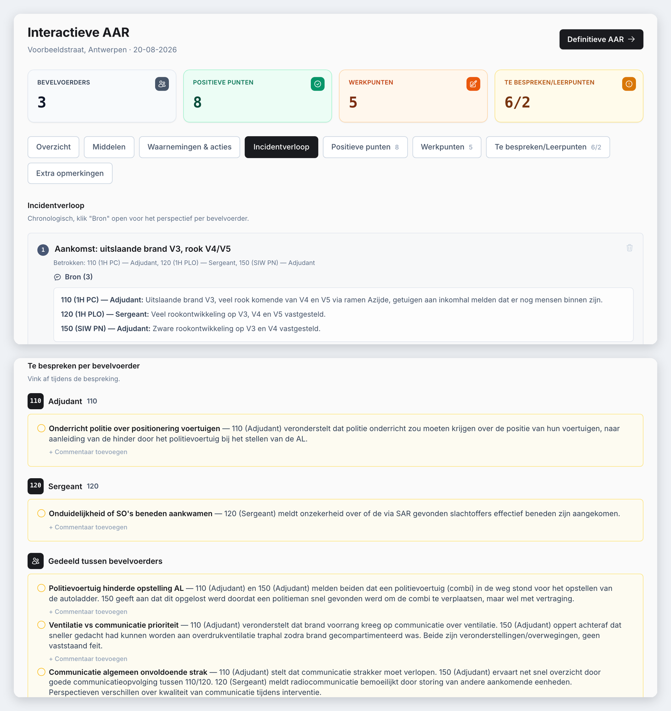

# AAR — AI-Assisted After Action Review

**Turns the written reports of every fire commander at an incident into one structured, chronological and fully traceable debrief, without letting the AI invent facts or judge people.**


[](https://github.com/DomienDarmontAntwerpen/AAR/actions/workflows/tests.yml)

> **In short:** after a major fire, each commander writes their own report. A good After Action Review (AAR) compares all of them, but in practice that is done by hand, if at all. This tool reads all the reports, rebuilds one shared timeline, and proposes discussion points, lessons and improvements. Every point links back to the exact sentence it came from. A human facilitator stays in control and has the final word.
>
> Built for fire services, but adaptable to any team that reviews its work together, from police and EMS to administrative or project teams that hold debriefs and evaluation meetings. Only the report template, labels and prompts change (see [Adapting AAR](#adapting-aar-to-another-team)).



*Fictional demo incident; no real incident data.*

> **Why the interface is in Dutch:** AAR was piloted on a Belgian (Flemish) fire service example, so the user interface, the report template and the AI prompts are in Dutch, the language the commanders write their reports in. The code, documentation and tests are in English. The glossary below translates the screen terms.

---

## What it does

1. **Intake**: each commander submits a standard report (`.docx` template or a Google Form), plus the dispatch export and optional photos or plans.
2. **AI analysis**: extracts what each commander reported, reconstructs one chronological view of the incident, and proposes discussion points, positive findings, lessons and improvements.
3. **Facilitated review**: an interactive debrief screen with per-commander findings side by side, a compare view, live notes, and full edit control.
4. **Finalize**: a finished AAR is locked against further edits and stays searchable in the archive. It can be explicitly reopened if needed.

<details>
<summary>Interface glossary (Dutch → English)</summary>

| On screen | Meaning |
|---|---|
| Interactieve AAR / Definitieve AAR | Interactive review / Final report |
| Bevelvoerders | Commanders (incident officers) |
| Overzicht · Middelen · Waarnemingen & acties | Overview · Resources · Observations & actions |
| Incidentverloop | Incident timeline |
| Positieve punten · Werkpunten | What went well · Points for improvement |
| Te bespreken / Leerpunten | Discussion points / Lessons learned |
| Extra opmerkingen | Additional remarks |
| Bronnen · Analyse · Archief | Sources · Analysis · Archive |
| Bron (4) | Linked to 4 source passages |
| Eindbalans | Final outcome of the incident |
| 6/2 (Te bespreken/Leerpunten) | 6 discussion points, 2 lessons learned |
</details>

## Responsible-AI rules (enforced in code)

- **Never invents a timestamp.** An unknown time stays unknown.
- **Never silently resolves a disagreement** between commanders. Conflicts are shown explicitly.
- **Never scores or judges** an individual's performance. The output stops at lessons and improvements.
- **Every AI-derived point is traceable** to the literal source text.
- **Two tabs are never AI-filtered**: everything a commander wrote under "Werkpunten" and "Extra opmerkingen" always comes through in full.

Where a gap could be checked (ordering, coverage, duplication), it was closed with deterministic code rather than more prompting.

## How it works

```
 .docx reports / Google Form  +  dispatch .xlsx  +  photos
                    │
                    ▼
          ingestion/  (parse & normalise every source)
                    │
                    ▼
          analysis/pipeline
   extraction → reconstruction → timeline → findings → lessons → narrative
                    │            (each step: Pydantic-validated LLM output)
                    ▼
          SQLite (SQLAlchemy)  ◄──►  services/  ◄──►  web/ (FastAPI + Jinja2)
                    │
                    ▼
          Facilitator reviews, corrects, re-runs, finalizes
```

The LLM sits behind a provider interface (`aar/llm/`). For real analysis, AAR uses Claude. A **deterministic mock** provider is also included so the test suite and a quick demo run without an API key. The mock does not analyse anything: it only arranges the submitted text, so use Claude for real reviews.

## Tech stack

| Layer | Technology |
|---|---|
| Backend | FastAPI, server-rendered Jinja2 + Tailwind (no Node.js build) |
| Data | SQLAlchemy, SQLite, Pydantic schemas |
| AI | Anthropic Claude, behind a swappable provider interface |
| Document parsing | python-docx, pandas, openpyxl |
| Testing | pytest (unit + integration), deterministic mock LLM |

## Getting started

### Prerequisites
- Python 3.11+
- An Anthropic API key for real AI analysis (without one, only the demo mock runs)

### Installation
```bash
git clone https://github.com/DomienDarmontAntwerpen/AAR.git
cd AAR
python3 -m venv .venv
source .venv/bin/activate
pip install -r requirements.txt
```

### Configuration
```bash
cp -n .env.example .env   # -n: never overwrites an existing .env
```
Set `AAR_LLM_PROVIDER=anthropic` and fill in `ANTHROPIC_API_KEY` for real AI analysis. Without a key, leave `AAR_LLM_PROVIDER=mock` (demo mode, no real analysis).

### Run
```bash
uvicorn app:app --reload
```
Open http://127.0.0.1:8000. To load a fully synthetic example incident:
```bash
python scripts/run_synthetic_demo.py
```

## Running the tests
```bash
pytest
```
145 unit and integration tests, all running against the deterministic mock (no API key needed).

## Project structure
```
AAR/
├── aar/
│   ├── ingestion/   # Parsers: commander .docx, Google Form sheet, dispatch export
│   ├── analysis/    # Extraction, reconstruction, timeline, findings, lessons
│   ├── config/      # Settings and logging
│   ├── db/          # Database engine and sessions
│   ├── llm/         # Provider interface, Anthropic provider, mock, prompts
│   ├── models/      # SQLAlchemy models
│   ├── schemas/     # Pydantic schemas for every LLM output
│   ├── services/    # Business logic between web layer and database
│   ├── ui/          # Dutch display labels
│   └── web/         # FastAPI routes and Jinja2 templates
├── docs/images/     # Screenshots (fictional demo incident)
├── fixtures/        # Synthetic demo incident (no real data)
├── scripts/         # Demo runner, template generator, screenshot smoke test
├── templates/       # Commander report template (.docx)
├── tests/           # Unit + integration tests
├── app.py
└── requirements.txt
```

## Adapting AAR to another team
The domain lives in a few central files, not in the analysis pipeline:
- `templates/`: the report template commanders fill in
- `aar/schemas/constants.py`: categories and unit names
- `aar/ui/labels.py`: the labels shown on screen
- `aar/llm/prompts/`: the instructions given to the AI

## Status & next steps
Working end to end. Currently a single-team tool (one shared login, one SQLite database). Before a wider rollout, the next steps are multi-user accounts, PostgreSQL and automated backups.

## Author
**Domien Darmont** — Operational leader building applied AI systems, Antwerp, Belgium  
GitHub: [@DomienDarmontAntwerpen](https://github.com/DomienDarmontAntwerpen)  
LinkedIn: [Domien Darmont](https://www.linkedin.com/in/domiendarmont/)

A live demo, the project presentation or answers to any questions are available on request.

## License
© 2026 Domien Darmont. All rights reserved.

The source code of this project is published for viewing and evaluation only. No permission is granted to copy, modify, distribute or use it, in whole or in part, without prior written consent from the author.
