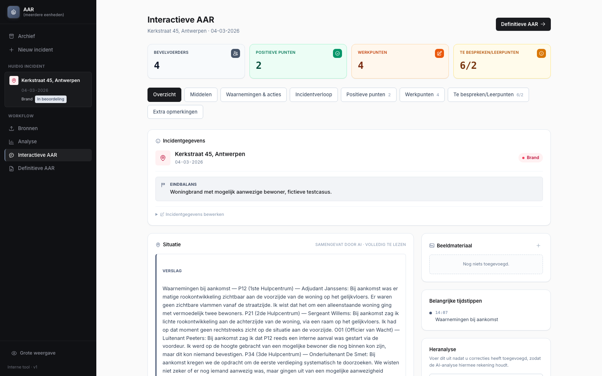
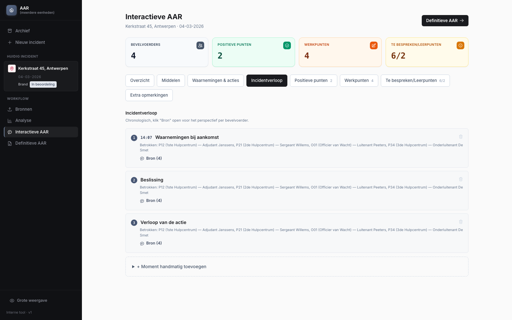

# AAR — AI-Assisted After Action Review

**Turns the written reports of every fire commander at an incident into one structured, chronological and fully traceable debrief, without letting the AI invent facts or judge people.**


> **In short:** after a major fire, each commander writes their own report. A good After Action Review (AAR) compares all of them, but in practice that is done by hand, if at all. This tool reads all the reports, rebuilds one shared timeline, and proposes discussion points, lessons and improvements. Every point links back to the exact sentence it came from. A human facilitator stays in control and has the final word.
>
> Built for and piloted at a Belgian fire brigade zone, and used on real incidents.



---

## What it does

1. **Intake**: each commander submits a standard report (`.docx` template or a Google Form), plus the dispatch export and optional photos or plans.
2. **AI analysis**: extracts what each commander reported, reconstructs one chronological view of the incident, and proposes discussion points, positive findings, lessons and improvements.
3. **Facilitated review**: an interactive debrief screen with per-commander findings side by side, a compare view, live notes, and full edit control.
4. **Finalize**: a finished AAR is locked against further edits and stays searchable in the archive. It can be explicitly reopened if needed.



*Screenshots show a fully synthetic demo incident. The interface is in Dutch, for Flemish fire services.*

## Responsible-AI rules (enforced in code)

- **Never invents a timestamp.** An unknown time stays unknown.
- **Never silently resolves a disagreement** between commanders. Conflicts are shown explicitly.
- **Never scores or judges** an individual's performance. The output stops at lessons and improvements.
- **Every AI-derived point is traceable** to the literal source text.
- **Two tabs are never AI-filtered**: everything a commander wrote under "Werkpunten" and "Extra opmerkingen" always comes through in full.

Where a gap could be checked (ordering, coverage, duplication), it was closed with deterministic code rather than more prompting.

## How it works

```
 .docx reports / Google Form  +  dispatch .xlsx  +  photos
                    │
                    ▼
          ingestion/  (parse & normalise every source)
                    │
                    ▼
          analysis/pipeline
   extraction → reconstruction → timeline → findings → lessons → narrative
                    │            (each step: Pydantic-validated LLM output)
                    ▼
          SQLite (SQLAlchemy)  ◄──►  services/  ◄──►  web/ (FastAPI + Jinja2)
                    │
                    ▼
          Facilitator reviews, corrects, re-runs, finalizes
```

The LLM sits behind a provider interface (`aar/llm/`). The default provider is a **deterministic mock**, so the whole app and test suite run without an API key. Switching to Claude only takes one environment variable.

## Tech stack

| Layer | Technology |
|---|---|
| Backend | FastAPI, server-rendered Jinja2 + Tailwind (no Node.js build) |
| Data | SQLAlchemy, SQLite, Pydantic schemas |
| AI | Anthropic Claude, behind a swappable provider interface |
| Document parsing | python-docx, pandas, openpyxl |
| Testing | pytest (unit + integration), deterministic mock LLM |

## Getting started

### Prerequisites
- Python 3.11+
- Optional: an Anthropic API key (without one the app uses the mock provider)

### Installation
```bash
git clone https://github.com/DarmontDomienAntwerpen/AAR.git
cd AAR
python3 -m venv .venv
source .venv/bin/activate
pip install -r requirements.txt
```

### Configuration
```bash
cp .env.example .env
```
By default `AAR_LLM_PROVIDER=mock`. For real AI analysis, set `AAR_LLM_PROVIDER=anthropic` and fill in `ANTHROPIC_API_KEY`.

### Run
```bash
uvicorn app:app --reload
```
Open http://127.0.0.1:8000. To load a fully synthetic example incident:
```bash
python scripts/run_synthetic_demo.py
```

## Running the tests
```bash
pytest
```
142 unit and integration tests, all running against the deterministic mock (no API key needed).

## Project structure
```
AAR/
├── aar/
│   ├── ingestion/   # Parsers: commander .docx, Google Form sheet, dispatch export
│   ├── analysis/    # Extraction, reconstruction, timeline, findings, lessons
│   ├── llm/         # Provider interface, Anthropic provider, mock, prompts
│   ├── models/      # SQLAlchemy models
│   ├── schemas/     # Pydantic schemas for every LLM output
│   ├── services/    # Business logic between web layer and database
│   └── web/         # FastAPI routes and Jinja2 templates
├── docs/images/     # Screenshots (synthetic data)
├── fixtures/        # Synthetic demo incident (no real data)
├── scripts/         # Demo runner, template generator, screenshot smoke test
├── templates/       # Commander report template (.docx)
├── tests/           # Unit + integration tests
├── app.py
└── requirements.txt
```

More documentation:
- [HANDOFF.md](HANDOFF.md): installation, configuration and operation in detail
- [PROJECT_STATE.md](PROJECT_STATE.md): design decisions and full change history

## Status & next steps
In active pilot use on real incidents. Currently a single-team tool (one shared login, one SQLite database). Before a wider rollout, the next steps are multi-user accounts, PostgreSQL and automated backups.

## Author
**Domien Darmont**, AI Engineer, Antwerp, Belgium
GitHub: [@DarmontDomienAntwerpen](https://github.com/DarmontDomienAntwerpen)
